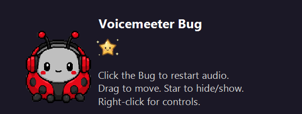

*A pet app by Astra.*

# Voicemeeter Bug

A small Windows desktop pet that requests a supported Voicemeeter audio-engine restart when you click him. He can also request a restart after a selected hardware output disconnects and reconnects.

**Automatic recovery detects device reconnects, not robotic sound or other audible distortion.** If the cable glitches while Windows still reports a connected device, click Bug or press **Ctrl+Alt+F10**. Audio briefly pauses during a restart. An accepted restart command does not prove that the sound you hear has recovered.



Prepared for local use with **OpenAI Codex (GPT-6), 2026-10-11**, America/Denver. The helper is built and installed locally; this work does not publish a GitHub repository or release.

## How to run it

Requires 64-bit Windows, Windows .NET Framework, and an installed compatible Voicemeeter version with its 64-bit Remote API. The build uses the .NET Framework C# compiler included with Windows; it does not download packages or include Voicemeeter's binaries.

Open Windows PowerShell in this folder. If an earlier Bug is running, use **Quit Bug** in its tray menu before rebuilding its executable.

```powershell
powershell.exe -NoProfile -File .\build-voicemeeter-bug-20261008.ps1
.\voicemeeter-bug-20261008.exe
```

The build embeds the nine `bug-*-20261008.png` frames and the app icon. `voicemeeter-bug-20261008.exe` is the normal executable; candidate builds and compiled files are local outputs and are not committed.

- Click Bug, or press **Ctrl+Alt+F10**, to request an audio restart.
- Drag Bug or the star to move them. Click the standalone star to hide or show Bug.
- Right-click either, or use the tray icon, for automatic recovery, status/help, startup, and quit controls.
- **Start with Windows** is an explicit menu setting. Building the app does not enable it.
- Launching the normal executable again reveals the existing instance. It does not create another watcher or request a restart.

## Hosted mode

[Astra's Pet Apps](https://github.com/findastra/astras-pet-apps) can supply the visible Bug and star while this app keeps the watcher and hotkey running:

```powershell
.\voicemeeter-bug-20261008.exe --hosted
```

If Bug is already running, hosted mode sends the existing instance a command to hide its standalone windows. A single click on the host's Bug requests repair; a double-click opens status/help. The host and this audio helper have separate lifetimes. Closing the host does not stop audio monitoring; **Quit Bug** does. A host status such as `bug_present` describes its loaded pet, not this helper's audio health.

## Automatic recovery

The watcher matches Voicemeeter's selected hardware outputs to Windows render endpoints. An observed disconnect followed by a stable reconnect can trigger a restart after a two-second settling period. It uses a 30-second automatic cooldown and permits at most three automatic attempts in ten minutes. Events arriving during cooldown remain pending. Manual requests have a five-second cooldown.

Changing automatic recovery or A1 ownership clears pending repairs and collects a fresh three-second baseline. Turning automatic recovery back on does not replay device events from when it was disabled. Existing cooldown and attempt limits remain in effect.

The **Also watch A1** setting is intended for a setup where Voicemeeter's own native A1 restart has been disabled. With the native-A1 setting enabled in Bug, Bug excludes A1 from its own recovery, assuming Voicemeeter will handle it. This helper does not read or verify Voicemeeter's native option; the menu setting does not configure it. Do not enable two independent recovery controllers for the same output.

Recovery uses Voicemeeter's installed Remote API. It does not intentionally change routing, gain, or mute choices, and it does not force-kill Voicemeeter.

## Diagnostics and local data

Runtime preferences and watcher data stay under `%LOCALAPPDATA%\findastra\voicemeeter-bug`. Self-test reports are written beside the installation under `bin/`. No microphone, call, or playback audio is recorded.

The watcher writes structured JSONL diagnostics every five seconds to `watcher-YYYYMMDD.jsonl`, using America/Denver dates. Each diagnostics file is capped at 2 MiB. Retention is global across dates: one active file plus at most three retained files from earlier dates or size-based rotations, for at most 8 MiB in that diagnostics set. Legacy recovery logs, preferences, and separately requested reports are outside that diagnostics-file cap.

Manual repair records diagnostic snapshots before and after the request. These describe device/API state and the request's result; they cannot establish the quality of sound reaching the headphones. Diagnostics can contain local device names and identifiers, so they are excluded from version control.

| Command | Effect |
| --- | --- |
| `--self-test` | Runs deterministic checks using fake APIs and writes `bin/self-test-results-YYYYMMDD.json` beside the installation; does not restart live audio. |
| `--diagnose` | Writes a separate device report with automatic repair disabled in that probe. |
| `--check` | Asks the existing app to write UI and watcher status; inspect the report's timestamp. |
| `--status` | Opens status/help, starting the helper if needed. |
| `--hosted` | Hides the standalone pet windows while retaining the watcher and hotkey. |
| `--repair` | Requests a real manual audio restart, subject to its cooldown. |
| `--preview` | Regenerates the local preview and icon files. |
| `--test-gestures` | Disables manual repair actions for gesture testing; it is not the fake-API self-test. |
| `--quit` | Asks the running Bug to exit cleanly. |

The executable is a GUI app and does not print a console result. Run the fake-API checks after building, wait for completion, and inspect both its exit code and JSON report:

```powershell
$bugSelfTest = Start-Process -FilePath '.\voicemeeter-bug-20261008.exe' -ArgumentList '--self-test' -WindowStyle Hidden -Wait -PassThru
Write-Output ('Self-test exit code: ' + $bugSelfTest.ExitCode)
$bugReportDate = [TimeZoneInfo]::ConvertTimeFromUtc([DateTime]::UtcNow, [TimeZoneInfo]::FindSystemTimeZoneById('Mountain Standard Time')).ToString('yyyyMMdd')
Get-Content -LiteralPath ('.\bin\self-test-results-' + $bugReportDate + '.json')
```

Exit code `0` indicates success; a nonzero exit code indicates failure. Check the report's timestamp and results rather than relying on an older report. The report date uses America/Denver time.

Local verification results are recorded in [pet.json](pet.json). A pending result means that check has not yet been recorded as passed for this preparation.

## Limits

- The watcher cannot detect distortion that produces no observable device reconnect. Silence and a zero sample-rate reading do not independently trigger repair.
- Fake-API tests do not validate physical cable behavior, driver recovery, or what a person hears after a restart.
- Cooldown deadlines currently use UTC wall time. An unusual backward system-clock correction can extend a cooldown; the Voicemeeter menu remains a manual fallback.
- API acceptance confirms only that a command was accepted. Physical audio recovery needs a listening check.
- Nine mood frames are embedded, but the native renderer currently uses idle, blink, and happy. The complete shared nine-mood lifecycle is not implemented.
- Hosted integration depends on the separately installed desktop-pets host. This repository does not install, repair, or publish that host.
- Publication, release packaging, and GitHub topic configuration are separate work. This local preparation makes no live-release claim.

## Pet-app conventions and provenance

The metadata follows [the pet file conventions](https://github.com/findastra/astras-pet-apps/blob/main/PET-FILES.md). Changes to this pet's job, status, audit, or public description are submitted to the Friendly Farmer through `cage.submit` in `pet.json`; generated hub files are not edited here.

The existing local guide records the Bug artwork as generated with the built-in image-generation tool on 2026-10-08. The existing PNG mood frames, icon, and preview are retained. The original generation record is not included in this repository, so that attribution is documented provenance rather than a new independent rights audit. Voicemeeter and its Remote API remain separately installed third-party software; their binaries are not redistributed here.

See [AGENTS.md](AGENTS.md) for maintenance rules and [CLAUDE.md](CLAUDE.md) for the assistant entry point.

## Desktop pet update - 2026-10-11
Hosted desktop pet reduced 20%; audio recovery behavior unchanged. Desktop artwork status: draft. Manifest: [desktop-pet-20261011.json](desktop-pet-20261011.json). The native companion renders this art; existing browser interface behavior is unchanged. Generated character artwork uses OpenAI image generation; source sheets and derived frames are included where applicable. Public credit: Astra. Integrated by OpenAI Codex (GPT-6).
